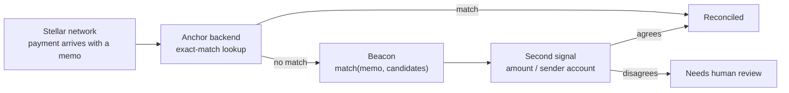

<p align="center">
  
</p>

<h1 align="center">Beacon</h1>

<p align="center">
  
  
</p>

<p align="center"><strong>Docs: <a href="https://buendia-builders.github.io/Beacon/">BuenDia-Builders.github.io/Beacon</a></strong></p>

Fuzzy matching for Stellar payment memos and references. No server, no
runtime dependencies, no ledger access — just a scoring function.

**v0.1, MVP.** See [docs/SPEC.md](docs/SPEC.md) for scope,
[docs/ROADMAP.md](docs/ROADMAP.md) for what's next, and
[docs/why.md](docs/why.md) for the problem this solves.

**Read [docs/LIMITATIONS.md](docs/LIMITATIONS.md) before using this for real
money.** Short-hand version: Beacon is for human- or bank-relayed *text*
references (an invoice code, a reworded memo) — not for auto-generated
random numeric memo IDs, where exact match (what you already have) is the
correct behavior and Beacon can confidently return the wrong match.

## Install

```bash
npm install @buendia-builders/beacon
```

## Usage

```ts
import { match } from "@buendia-builders/beacon";

match("INV12E4", ["INV1234", "INV9999", "REF-1234"]);
// [{ candidate: "INV1234", score: 0.857... }]
```

`match(query, candidates, options?)` ranks candidates by similarity,
tolerant to typos, reordering, and extra words. `options.threshold`
(default `0.5`) and `options.limit` (default `5`) control the cutoff and
page size.

## Real-world examples

Runnable, validated scenarios in [`examples/`](examples) — not the one-liner
above, full integration patterns:

- [`custom-text-memo.mjs`](examples/custom-text-memo.mjs) — typo'd,
  reordered, and reworded memos against a custom reference scheme.
- [`reconcile-with-second-signal.mjs`](examples/reconcile-with-second-signal.mjs) —
  the safe pattern: only auto-confirm when the memo match agrees with a
  second signal (amount).
- [`dont-use-for-numeric-ids.mjs`](examples/dont-use-for-numeric-ids.mjs) —
  what *not* to do, and why.

```bash
node examples/custom-text-memo.mjs
```

## Comparison

| | Beacon | `fastest-levenshtein` | `fuse.js` | Elasticsearch |
|---|---|---|---|---|
| What it is | One scoring function | One edit-distance function | Client-side fuzzy search lib | Distributed search server |
| Dependencies | Zero | Zero | Zero | A cluster |
| Reordered/extra words | Yes (token overlap) | No (whole-string only) | Yes | Yes |
| Built for | Memo/reference matching | Generic string distance | UI search boxes | General full-text search |

If you just need raw edit distance, `fastest-levenshtein` is smaller. If
you're already running Elasticsearch for something else, use that. Beacon
exists for the case in between: a short list of expected references, no
server, and both typo- and word-order-tolerance out of the box.

## Architecture

Beacon only runs when the anchor's own exact-match lookup already failed —
it's a fallback, not a replacement. Its output still needs a second signal
(amount, sender account) before a payment is actually reconciled; see
[docs/LIMITATIONS.md](docs/LIMITATIONS.md).



## License

MIT
